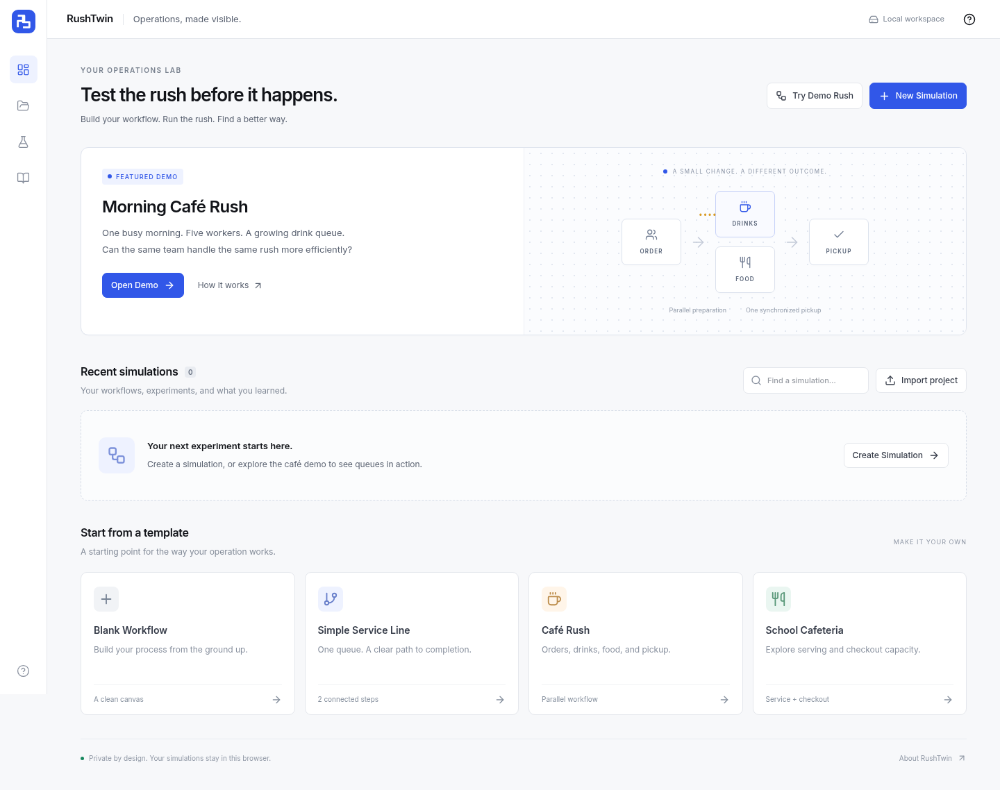

<div align="center">
  
  <h1>RushTwin</h1>
  <p><strong>Test the rush before it happens.</strong></p>
  <p>A visual simulator for testing how a service workflow handles a busy period.</p>
  <p>
    <a href="https://tgpatel-tech.github.io/RushTwin/">Open the app</a> ·
    <a href="https://tgpatel-tech.github.io/RushTwin/#/demo">Try the café demo</a> ·
    <a href="SIMULATION_ENGINE.md">Explore the engine</a> ·
    <a href="docs/SUBMISSION_GUIDE.md">Submission preparation</a>
  </p>
  <p>
    <a href="https://github.com/tgpatel-tech/RushTwin/actions/workflows/pages.yml">
      
    </a>
  </p>
</div>


## What I'm working on

My goal with RushTwin is to make it easier to test an operational change before trying it during a real rush. A team can have enough people overall and still get stuck at one station. I want the app to make that problem visible.

RushTwin lets you build a workflow, run customer demand through it, change the setup, and replay the **same customers with the same arrival times**. That makes it easier to see what the change actually did.

The café demo is the starting point: five workers handle ordering, drinks, food, and pickup. Move one worker from Order to Drinks, replay the rush, and compare the results. No extra worker is added.

## Try it in two minutes

1. Open the [Morning Café Rush demo](https://tgpatel-tech.github.io/RushTwin/#/demo).
2. Select **Run Baseline**. Watch the queues, or choose **Max** to jump to the results.
3. Select **Test a Change → Apply Experiment**.
4. Select **Replay Same Rush**, then **Compare the results**.
5. Look at both improvements and tradeoffs—not just the headline wait time.

No account, API key, or installation is needed to try the website.

## What the app can do

| Area | What's implemented |
| --- | --- |
| Workflow editor | Add, move, connect, and configure stations; change workers and processing times; undo and redo edits. |
| Simulation | FIFO queues, limited worker capacity, variable service times, parallel tasks, and synchronized pickup. |
| Replay | Preserve arrival times, order types, and customer-specific service randomness while changing the operation. |
| Results | Average and P90 wait, throughput, utilization, queue history, customer details, and bottleneck evidence. |
| Data | Import CSV arrivals, validate problematic rows, and export or import complete project configurations. |
| Storage | Save projects locally in the browser without sending customer data to a server. |

<details>
<summary><strong>See the dashboard and scenario comparison</strong></summary>




These screenshots show the application running its seeded demo. The numbers come from the simulation; they are not fixed values used by the interface.

</details>

## How the simulation works

The engine runs separately from the interface. A binary min-heap selects the next event by simulation time and insertion order. Each station has a FIFO queue and can process one task per available worker.

Drink and Food tasks can run in parallel. Pickup waits for every branch that the customer's order requires. Replay keeps the original demand and derives service randomness from the seed, customer ID, and station ID, so changing staffing doesn't quietly change each customer's work.

The event heap, seeded generator, queues, dependency handling, replay, and metrics are application-specific code. XYFlow draws the workflow and Recharts draws the charts; neither runs the simulation.

See [the engine explanation](SIMULATION_ENGINE.md) for the algorithms, formulas, and exact timing examples, or [the architecture](ARCHITECTURE.md) for a map of the code.

## Run locally

Use **Node.js 24** and npm.

```bash
git clone https://github.com/tgpatel-tech/RushTwin.git
cd RushTwin
npm ci
npm run dev
```

Open the local address printed by Vite. No backend or environment secrets are required.

```bash
npm run lint
npm run typecheck
npm run test
npm run build
npm run test:e2e:production
npm run test:e2e:pages
```

For browser tests, install Chromium with `npx playwright install chromium`, or use an existing browser through `PLAYWRIGHT_CHROMIUM_EXECUTABLE_PATH`. The test configuration also recognizes `/usr/bin/chromium`.

The test suite includes the required single-worker timing example, parallel-branch synchronization, deterministic replay, queue-area calculations, input validation, and a 1,000-customer/20-station case. [Testing details →](TESTING.md)

## Stack

**App:** React, TypeScript, Vite, Tailwind CSS, XYFlow, Zustand, Lucide.
**Data and charts:** Dexie/IndexedDB, Zod, Papa Parse, Recharts.
**Testing:** Vitest, React Testing Library, Playwright.
**Hosting:** GitHub Pages through GitHub Actions.

## A few important limits

- Results depend on the entered demand, timing, and workflow assumptions. They are estimates, not guarantees about a real business.
- Queue wait is summed across parallel tasks. It is not the same as elapsed time in the system.
- This version does not model breaks, customers abandoning queues, shared worker pools, or cyclic workflows.
- Projects stay in the browser where they were created. Export a `.rushtwin.json` backup before clearing storage or switching domains. Sharing a project URL does not share its saved data; the public demo works independently for each visitor.

## Documentation

| Guide | What it's for |
| --- | --- |
| [Architecture](ARCHITECTURE.md) | Code organization and data flow |
| [Simulation engine](SIMULATION_ENGINE.md) | Events, randomness, routing, and metric definitions |
| [Testing](TESTING.md) | Test commands and coverage |
| [Build status](BUILD_STATUS.md) | Implemented features and known limitations |
| [GitHub Pages setup](deployment/GITHUB_PAGES.md) | Deployment and hosted URLs |
| [Project explanation](COMPETITION_EXPLANATION.md) | A clear walkthrough for a reviewer |
| [Submission guide](docs/SUBMISSION_GUIDE.md) | Preparation steps and official requirements to verify |
| [AI usage](AI_USAGE.md) | How AI contributed to this project |
| [Contributing](CONTRIBUTING.md) | Reporting issues and proposing changes |

## Development transparency

I used OpenAI Codex extensively to help generate and debug this implementation, including the engine, interface, tests, and documentation. The technical descriptions explain what the code does; they are not a claim that I wrote every part without assistance. [AI_USAGE.md](AI_USAGE.md) records the scope of that assistance and separates automated checks from personal review.
