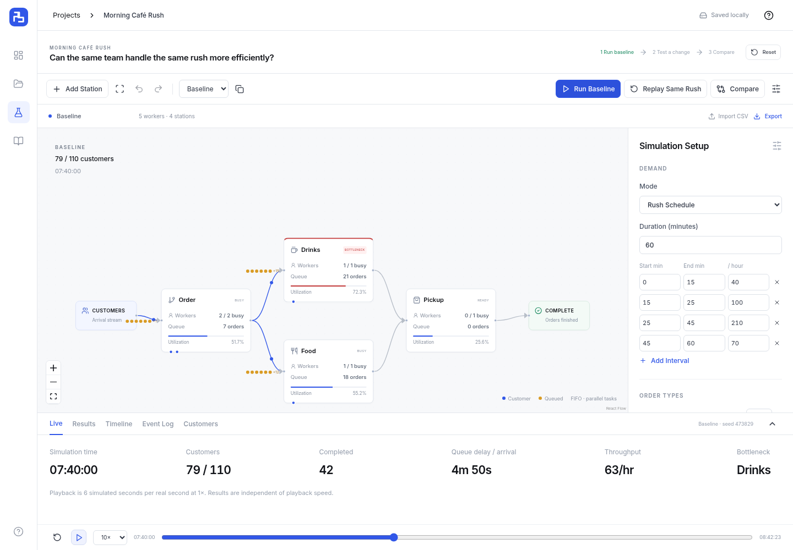
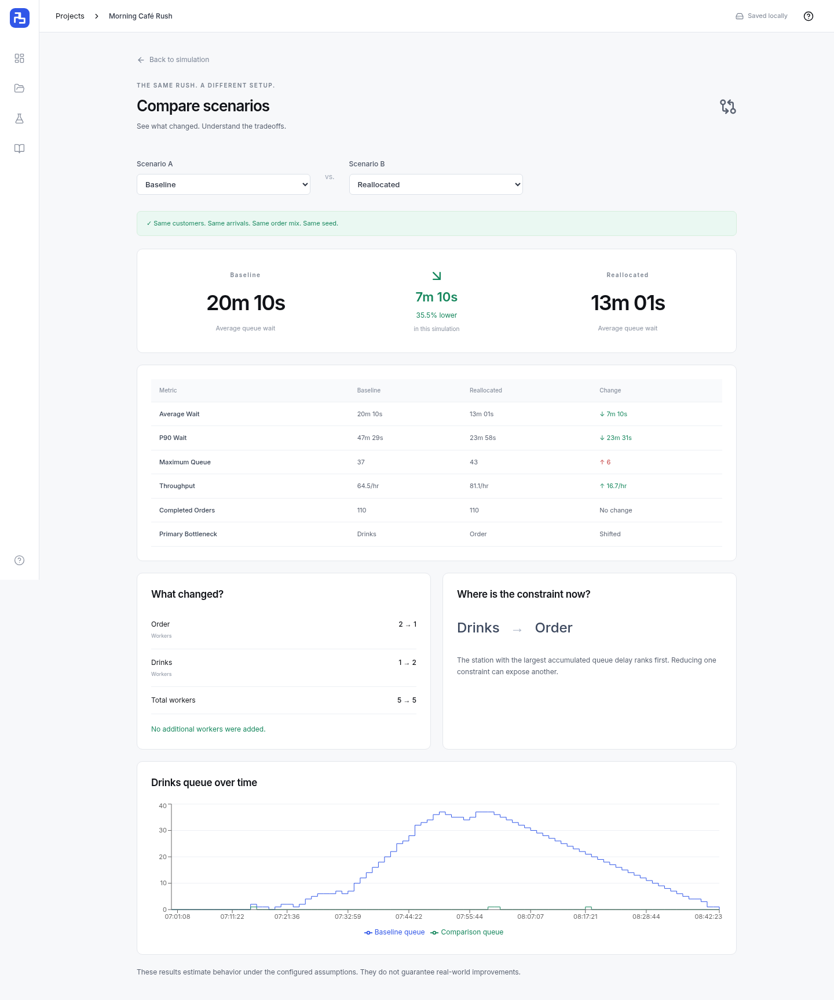

<div align="center">
  
  <h1>RushTwin</h1>
  <p><strong>Test the rush before it happens.</strong></p>
  <p>A visual simulator for testing how a service workflow handles a busy period.</p>
  <p>
    <a href="https://tgpatel-tech.github.io/RushTwin/">Open the app</a> ·
    <a href="https://tgpatel-tech.github.io/RushTwin/#/demo">Try the café demo</a> ·
    <a href="SIMULATION_ENGINE.md">Explore the engine</a>
  </p>
  <p>
    <a href="https://github.com/tgpatel-tech/RushTwin/actions/workflows/pages.yml">
      
    </a>
  </p>
</div>



RushTwin helps you test a workflow before changing it in real life. Build a setup, run a busy period, move workers, and replay the same customers to see what changes.

## Try it

1. Open the [café demo](https://tgpatel-tech.github.io/RushTwin/#/demo).
2. Select **Run Baseline**. Use **Max** to see the results sooner.
3. Select **Test a Change → Apply Experiment**.
4. Select **Replay Same Rush → Compare the results**.

The experiment moves one worker from Order to Drinks. Total staffing stays at five. Check both the improvements and the tradeoffs.

## Features

- Build workflows with stations, connections, workers, and service times.
- Simulate queues and tasks that happen in parallel.
- Replay the same demand to compare changes fairly.
- View wait times, throughput, worker utilization, and bottlenecks.
- Import customer arrivals from CSV.
- Save projects in your browser and export backups.



## Run locally

Use Node.js 24 and npm.

```sh
git clone https://github.com/tgpatel-tech/RushTwin.git
cd RushTwin
npm ci
npm run dev
```

No account, backend, or API key is needed.

## Checks

```sh
npm run lint
npm run typecheck
npm run test
npm run build
npm run test:e2e:production
npm run test:e2e:pages
```

Run browser checks one at a time. See [Testing](TESTING.md) for browser setup and coverage.

## Built with

React, TypeScript, Vite, Tailwind CSS, XYFlow, Zustand, Dexie, Recharts, Papa Parse, and Zod. The app uses its own discrete-event simulation engine. Vitest and Playwright cover testing; GitHub Actions deploys to GitHub Pages.

## Limits

Results depend on your input assumptions. The app does not model breaks, customers leaving queues, shared workers, or cyclic workflows. Queue wait adds delays across tasks, including parallel tasks; it is different from total elapsed time.

Projects stay in your browser. Export a `.rushtwin.json` backup before clearing storage or switching devices. A project link does not share its saved data; use the public demo or share an exported file. Exports do not include past runs.

## Documentation

- [Architecture](ARCHITECTURE.md)
- [Simulation engine](SIMULATION_ENGINE.md)
- [Testing](TESTING.md)
- [Hosting](deployment/README.md)
- [AI usage](AI_USAGE.md)
- [Contributing](CONTRIBUTING.md)
